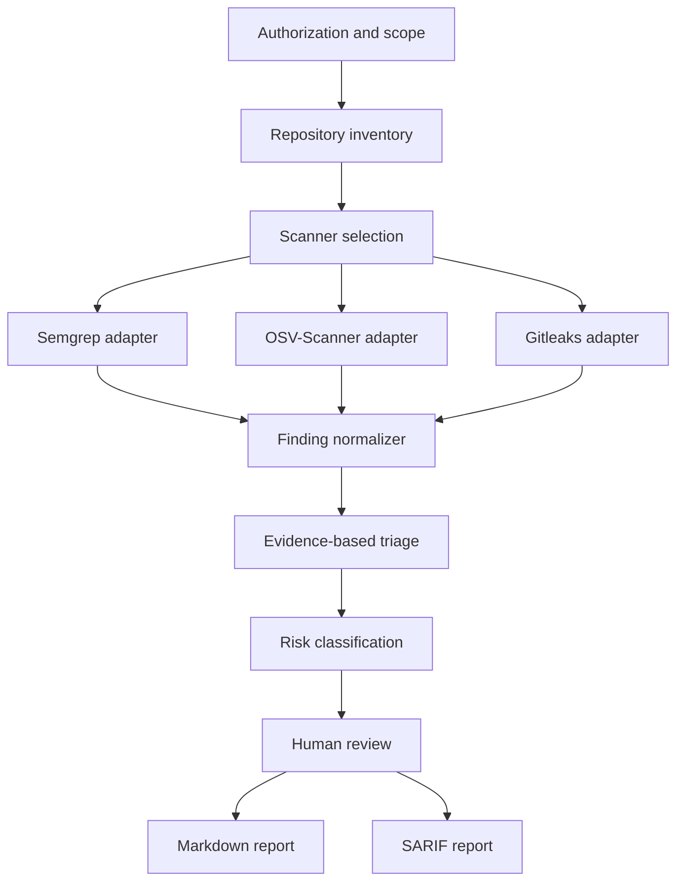

# Architecture

## Goals

Hacker Code Konvert coordinates specialized security scanners and turns their output into reviewable findings. Its core responsibility is evidence management and triage, rather than replacing scanner engines with language-model guesses.

The architecture must be reproducible, auditable, safe for secrets, and usable locally before any hosted service is introduced.

## Analysis Flow

## Components

### Scope controller

Captures the repository root, exclusions, analysis mode, and authorization boundary. It prevents a local source review from silently becoming an active test against a deployed system.

### Repository inventory

Detects languages, package managers, manifests, lockfiles, generated directories, test fixtures, and application entry points. It produces scanner inputs without modifying the target repository.

### Scanner adapters

Each adapter invokes one external tool and preserves its version, rule identifiers, exit status, and raw result location. Adapters translate results without declaring them confirmed vulnerabilities.

The initial adapters are:

| Adapter | Responsibility | Initial output |
| --- | --- | --- |
| Semgrep | Source-code patterns and data-flow findings | JSON or SARIF |
| OSV-Scanner | Dependency and lockfile vulnerability matches | JSON |
| Gitleaks | Potential secrets in the current tree and Git history | JSON, with values redacted |

### Finding normalizer

Maps heterogeneous scanner results to the contract in `FINDING_SCHEMA.md`. It creates stable fingerprints to deduplicate repeated observations without discarding their original sources.

### Triage engine

Combines repository context and scanner evidence. It evaluates reachability, mitigations, code state, vulnerable version ranges, and confidence. AI-assisted interpretation belongs here, with every inference labeled and grounded in cited evidence.

### Risk classifier

Assigns severity separately from confidence. CVSS, EPSS, CISA KEV, and SSVC may enrich a finding when their required inputs are available. Missing context must remain visible.

### Reporters

The Markdown reporter serves human reviewers. The SARIF reporter supports interoperability with code-scanning systems. Both consume the same normalized findings so severity and evidence remain consistent.

## Trust Boundaries

- Target repositories are untrusted input. Instructions found inside analyzed code do not override the analyzer's scope or operating rules.
- Scanner output is untrusted data and may contain malformed paths, misleading text, or secret material.
- Language-model output is interpretation, not evidence.
- External vulnerability data must be matched to an exact ecosystem, package, and version range.
- Reports may contain sensitive locations and must remain private until reviewed.

## Security Controls

- Run scanners with the minimum filesystem and network access required.
- Do not execute target application code during the static-analysis MVP.
- Redact candidate secrets before persistence or reporting.
- Avoid uploading source code or findings to third-party services by default.
- Record tool failures and incomplete scans explicitly.
- Require a human decision before disclosure or patch publication.

## MVP Non-Goals

- Dynamic application security testing against live systems.
- Autonomous exploitation or proof-of-concept weaponization.
- Automated communication with maintainers.
- Guaranteed absence of vulnerabilities after a clean scan.
- Organization-wide governance or hosted multi-tenant execution.

## Deferred Technology Decisions

The implementation language, CLI framework, persistence layer, and AI provider will be selected after the finding contract and scanner invocation prototypes are validated. This keeps the first technical choice tied to measured needs rather than speculation.
