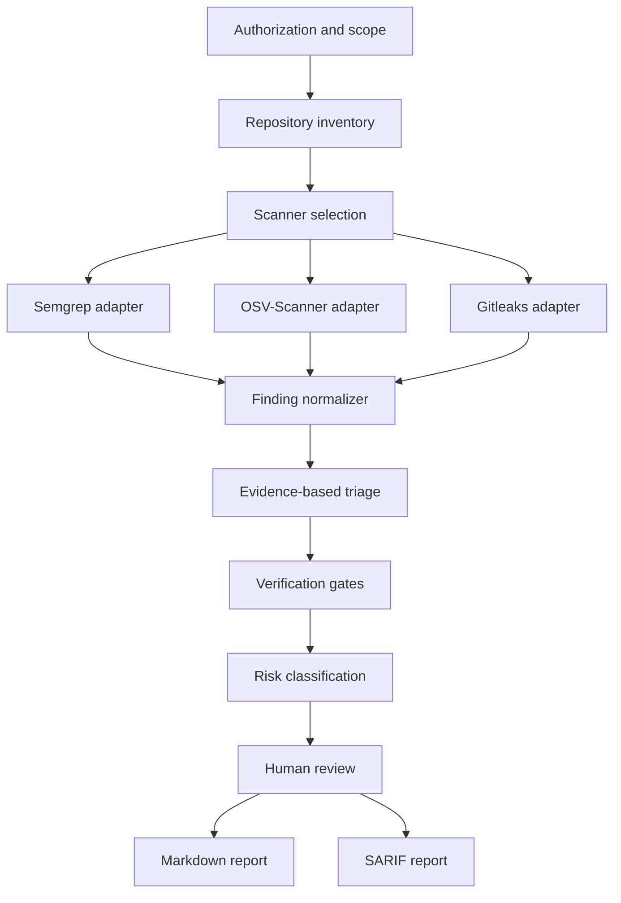

# Architecture

## Goals

Hacker Code Konvert coordinates specialized security scanners and turns their output into reviewable findings. Its core responsibility is evidence management and triage, rather than replacing scanner engines with language-model guesses.

The architecture must be reproducible, auditable, safe for secrets, and usable locally before any hosted service is introduced. The current enforcement layer is a Python 3.12 CLI; `SKILL.md` defines the agent-facing operating policy.

## Analysis Flow

## Components

### Scope controller

Captures the repository root, exclusions, analysis mode, and authorization boundary. It prevents a local source review from silently becoming an active test against a deployed system.

### Repository inventory

Detects languages, package managers, manifests, lockfiles, generated directories, test fixtures, and application entry points. It produces scanner inputs without modifying the target repository.

The implemented inventory rejects escaping output paths, does not follow symlinks or nested repositories, identifies Git LFS pointers, applies file and repository limits, and selects Python files for controlled staging.

### Scanner adapters

Each adapter invokes one external tool and preserves its version, rule identifiers, exit status, and raw result location. Adapters translate results without declaring them confirmed vulnerabilities.

The initial adapters are:

| Adapter | Responsibility | Initial output |
| --- | --- | --- |
| Semgrep | Source-code patterns and data-flow findings | JSON or SARIF |
| OSV-Scanner | Dependency and lockfile vulnerability matches | JSON |
| Gitleaks | Potential secrets in the current tree and Git history | JSON, with values redacted |

Only the Semgrep adapter is currently implemented. OSV-Scanner and Gitleaks remain roadmap items.

### Finding normalizer

Maps heterogeneous scanner results to the contract in `FINDING_SCHEMA.md`. It creates stable fingerprints to deduplicate repeated observations without discarding their original sources.

### Triage engine

Combines repository context and scanner evidence. It evaluates reachability, mitigations, code state, vulnerable version ranges, and confidence. AI-assisted interpretation belongs here, with every inference labeled and grounded in cited evidence.

AI-assisted interpretation is disabled in version 0.1.0. Scanner candidates retain unresolved gates for later human review.

### Verification gate evaluator

Records the outcome of each applicable gate in `VERIFICATION_GATES.md`. It preserves unresolved candidates and requires positive evidence before a finding is validated. It does not reduce every uncertain result to a binary true-positive or false-positive verdict.

### Risk classifier

Assigns severity separately from confidence. CVSS, EPSS, CISA KEV, and SSVC may enrich a finding when their required inputs are available. Missing context must remain visible.

### Reporters

The Markdown reporter serves human reviewers. The SARIF reporter supports interoperability with code-scanning systems. Both consume the same normalized findings so severity and evidence remain consistent.

Markdown output follows `REPORT_TEMPLATE.md`. Profile-specific context, including the e-commerce requirements in `ECOMMERCE_PROFILE.md`, enriches the normalized contract without changing its core verdict rules.

## Trust Boundaries

- Target repositories are untrusted input. Instructions found inside analyzed code do not override the analyzer's scope or operating rules.
- Documentation, comments, issue text, generated output, and configuration from a target repository may contain prompt injection and remain untrusted.
- Scanner output is untrusted data and may contain malformed paths, misleading text, or secret material.
- Language-model output is interpretation, not evidence.
- External vulnerability data must be matched to an exact ecosystem, package, and version range.
- Reports may contain sensitive locations and must remain private until reviewed.

## Security Controls

- Run scanners with the minimum filesystem and network access required.
- Do not execute target application code during the static-analysis MVP.
- Redact candidate secrets before persistence or reporting.
- Avoid uploading source code or findings to third-party services by default.
- Record tool failures and incomplete scans explicitly.
- Require a human decision before disclosure or patch publication.
- Stage only supported regular files and never mount the original repository into the scanner sandbox.
- Disable scanner network access and fail closed when the sandbox cannot be created.
- Bound scanner time, memory, open files, file size, repository size, and output size.
- Construct scanner commands as argument arrays without a shell.
- Discard raw scanner output after redacted normalization.

## MVP Non-Goals

- Dynamic application security testing against live systems.
- Autonomous exploitation or proof-of-concept weaponization.
- Automated communication with maintainers.
- Guaranteed absence of vulnerabilities after a clean scan.
- Organization-wide governance or hosted multi-tenant execution.

## Analysis Profiles

The same pipeline supports distinct profiles without applying one global filter policy:

| Profile | Scope |
| --- | --- |
| Repository | Full static review of one selected revision |
| Differential | Pull request, commit, or diff with baseline context and blast-radius analysis |
| Dependency | Package, advisory, reachability, and supply-chain analysis |
| E-commerce | Web, API, payment, and platform-aware review within an authorized scope |
| Active | Separately authorized interaction with named deployed targets; outside the MVP |

Profiles select applicable tools, rules, verification requirements, and reporting priorities. They never expand authorization.

## Deferred Technology Decisions

Python 3.12 and the standard library are selected for the MVP CLI. Reports use local files without a persistence service. No AI provider is selected or used; any future provider requires an explicit privacy and data-flow design.
